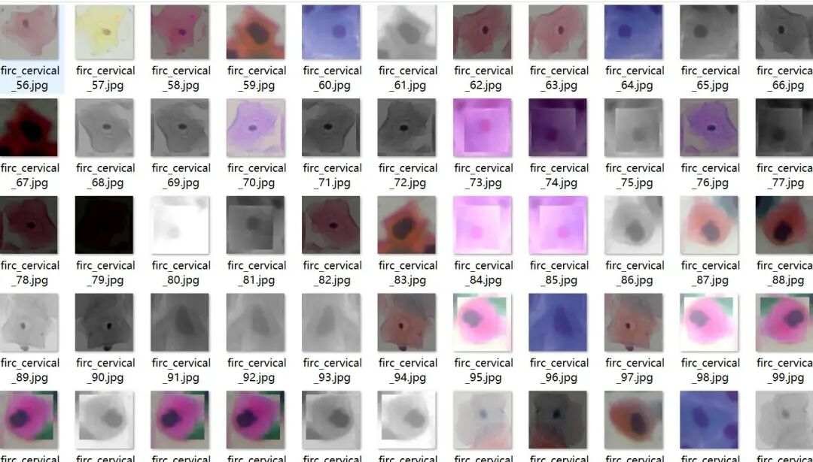
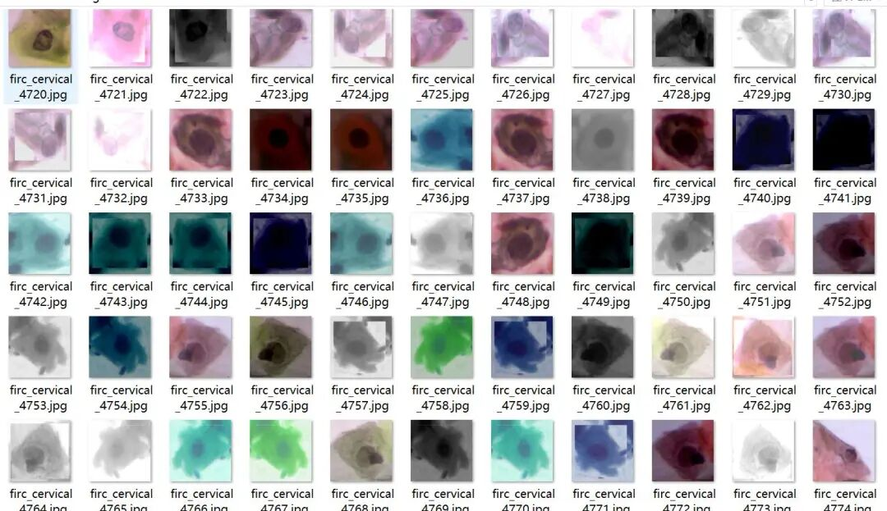
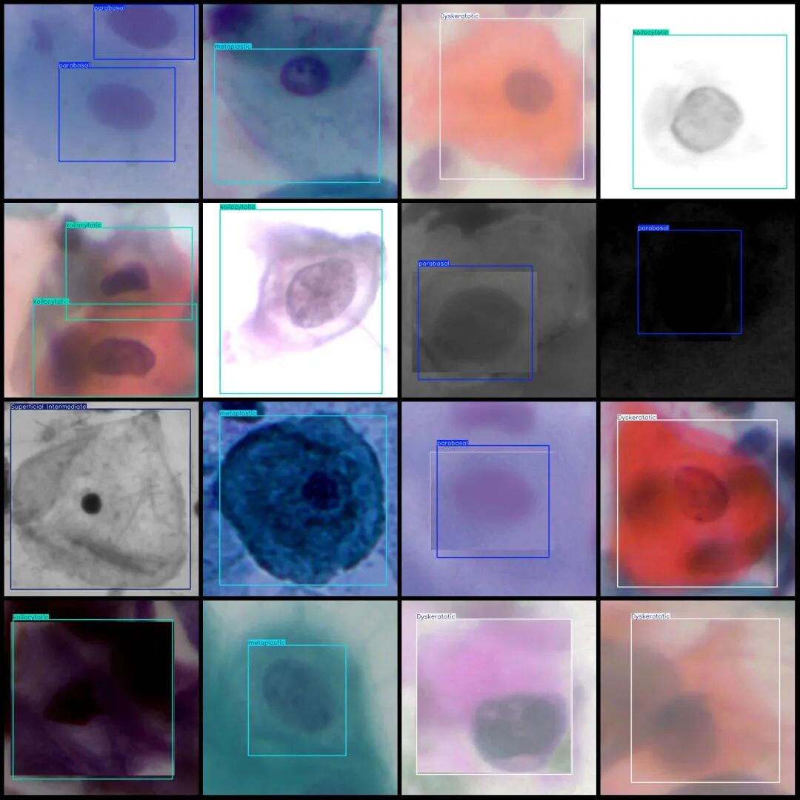

# HPV+Cervical Cancer Cell Pathology Detection Dataset VOC+YOLO format with 7574 images in 5 categories

Dataset format: Pascal VOC format + YOLO format (txt file without split path, only containing jpg images and corresponding VOC format xml files and yolo format txt files)

Number of images (number of jpg files): 7574

Number of annotations (number of xml files): 7574

Number of annotations (number of txt files): 7574

Label category count: 5

Label category names (note that the order of categories in the YOLO format does not correspond to this, but is based on the labels folder's classes.txt): ["Dyskeratotic", "Superficial Intermediate", "koilocytotic", "metaplastic", "parabasal"]

Dyskeratotic (abnormal keratinization cells): Abnormal keratinized cells associated with cervical pre-cancerous lesions.

- Superficial Intermediate (Surface intermediate cells): Reflects the normal mature phase of squamous epithelial cells

- koilocytotic (vacuolization cell): characteristic pathological change of HPV infection

- metaplastic (metaplastic cells): transitional cells during the process of squamous epithelium metaplasia

- parabasal (subbasal) cells: indicators of epithelial regeneration or inflammatory response

Number of boxes labeled in each category:

Dyskeratotic frame count = 1661

Superficial Intermediate Frame Count = 1802

1758

Metaplastic frame count = 1990

Parabasal frame count = 2461

Total frame count: 9672

Image resolution: 640x640

Is the dataset enhanced? Yes, there are about 3000 original images remaining, all of which are enhanced.

Using labelImg:

Annotation rules: Draw a rectangle around the category.

Important Notice: No

Special : This dataset does not guarantee the accuracy of the trained models or weight files.

Image Preview:

Annotation example:

## Payment

Here is a pay link on Stripe ( https://buy.stripe.com/3cs8yP7sY87d0vu9AB ). Please contact me lonlonago@foxmail.com after funding $89, and I will send you a complete data files , thank you!

